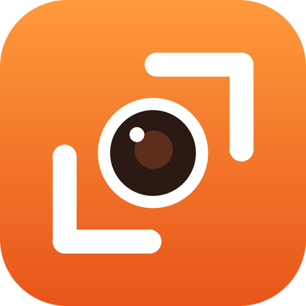
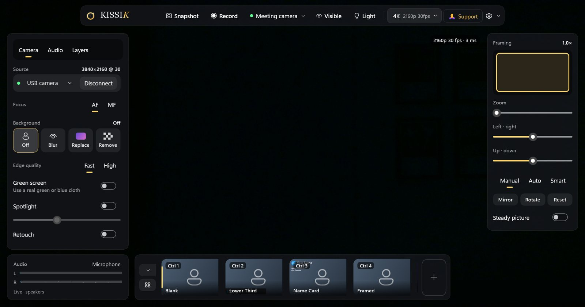
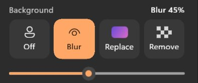
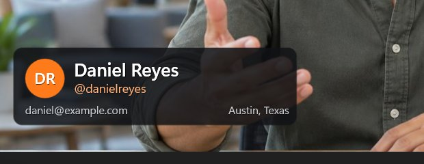
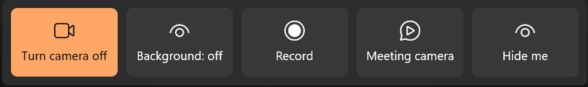

<div align="center">

<br/>



# KISSIK

### Free, open-source camera studio for Windows

<br/>

[](https://github.com/krigrv/Kissik--Camera-Studio-App/releases)
[](LICENSE)
[](https://github.com/krigrv/Kissik--Camera-Studio-App/releases)
[](https://github.com/krigrv/Kissik--Camera-Studio-App/actions)

<br/>

[**Download**](#download) · [**Features**](#features) · [**Contributing**](#contributing) · [**Support**](#support) · [**Privacy**](#privacy)

<br/>

Make any webcam, or your phone, look its best. Blur or replace your background, add your
name and logo, record, go live, and show up in Meet, Zoom and Teams.
**No account. No watermark. Nothing locked behind a paywall.**

</div>

> [!IMPORTANT]
> KISSIK is an independent project. It is not affiliated with, endorsed by or connected to any
> other camera or webcam software company. See [TRADEMARKS.md](TRADEMARKS.md).

---

<div align="center">



<h1><a id="features"></a>Features</h1>

<table>
  <tr>
    <td width="50%" valign="top">

#### Picture
- **Any webcam** with its real controls: focus, zoom, exposure, white balance.
- **Background**: blur, replace with a picture or video, remove, green screen.
- **Spotlight and retouch**, filters and your own `.cube` LUTs.
- **Framing**: zoom and pan, or let Auto and Smart framing follow you.
- **Up to 4K 60** and vertical 9:16, plus your own output profiles.
- **Screen light**: turn your monitor into a soft key light.

#### Your phone as a camera
- **KISSIK Camera for Android**: scan a QR code and you're live.
- Up to **4K** on back lenses, about **100 ms** camera to screen at 60 fps.
- Pro controls (lens, exposure, ISO, shutter, focus, torch, zoom) and the phone's mic.
- The phone's screen dims while it streams.

    </td>
    <td width="50%" valign="top">

#### Scenes and sharing
- **Scenes**: name cards, lower thirds, bubble cam, presentation and more.
- **Your details** (name, title, pronouns, logo, your own fields) fill every scene.
- **Meeting camera**: shows up in Meet, Zoom, Teams, Discord and OBS.
- **Record** exactly what you see, with sound; recordings survive a crash.
- **Replay buffer**: save the last 30 seconds. **Go live** to YouTube and Twitch.

#### Sound, access and control
- Microphone mixer, noise removal, EQ, limiter and system sound.
- **Live captions**, a prompter under the webcam, a privacy shutter.
- **Simple mode**: five big buttons for anyone who wants it easy.
- Keyboard and screen reader friendly, light and dark themes.
- **Ctrl+Alt shortcuts** that work from any app.

    </td>
  </tr>
</table>

<table>
  <tr>
    <td width="33%"><br/><sub><b>Background</b>: blur, replace or remove, with clean edges.</sub></td>
    <td width="33%"><br/><sub><b>Scenes</b>: your name and logo, in one click.</sub></td>
    <td width="33%"><br/><sub><b>Simple mode</b>: five big buttons.</sub></td>
  </tr>
</table>

</div>

---

<div align="center">

<h1><a id="download"></a>Download</h1>

**Windows 10 1809 or later** (Windows 11 recommended), x64 or ARM64.

Get the latest version from [**Releases**](https://github.com/krigrv/Kissik--Camera-Studio-App/releases):
the Windows installer and the **KISSIK Camera** Android app.

</div>

<details>
<summary><b>Build it yourself</b></summary>

<br/>

You need the [.NET 10 SDK](https://dotnet.microsoft.com/download) and the Windows App SDK runtime.

```powershell
dotnet build OpenKamera.slnx -c Release
dotnet test OpenKamera.slnx -c Release
dotnet run -c Release --project src\OpenKamera.App\OpenKamera.App.csproj
```

Start it with `dotnet run` (it registers the app) rather than the `.exe`. The Android app is in
`android/` (`./gradlew assembleDebug`). More in [docs/DEVELOPMENT.md](docs/DEVELOPMENT.md).

</details>

---

<div align="center">

<h1><a id="contributing"></a>Contributing</h1>

Bug reports, ideas, code, translations and scene templates are all welcome.
Please read the [Contributing Guide](CONTRIBUTING.md) and [Code of Conduct](CODE_OF_CONDUCT.md) first.

[**Report a bug**](https://github.com/krigrv/Kissik--Camera-Studio-App/issues/new?template=bug_report.yml) ·
[**Suggest a feature**](https://github.com/krigrv/Kissik--Camera-Studio-App/issues/new?template=feature_request.yml) ·
[**Ask a question**](https://github.com/krigrv/Kissik--Camera-Studio-App/discussions) ·
[**Roadmap**](ROADMAP.md)

### Thanks to everyone who helps ❤

<a href="https://github.com/krigrv/Kissik--Camera-Studio-App/graphs/contributors">
  
</a>

</div>

---

<div align="center">

<h1><a id="support"></a>Support</h1>

KISSIK is free and stays free. If it helps you, you can help keep it going.

[](https://paypal.me/krishnagaurav)
[](docs/donate-upi-qr.png)


<sub>Scan with Google Pay, PhonePe, Paytm or BHIM. A ⭐ on this page helps too.</sub>

</div>

---

<h2><a id="privacy"></a>Privacy</h2>

Everything happens on your PC: video, sound and the AI that finds you never leave it. No account,
no tracking. Crash reports are off until you say yes. KISSIK may show one small card marked
"Sponsored" in its own window, chosen on your PC with nothing sent about you, and you can turn it
off in Settings and help. Never an ad in your video. Details in [docs/PRIVACY.md](docs/PRIVACY.md).

## Licence

Copyright © 2026 Krishna Gaurav and KISSIK contributors. Free software under the
**GNU General Public License v3.0**: see [LICENSE](LICENSE). Bundled models and libraries keep
their own licences, listed in [THIRD_PARTY.md](THIRD_PARTY.md).
